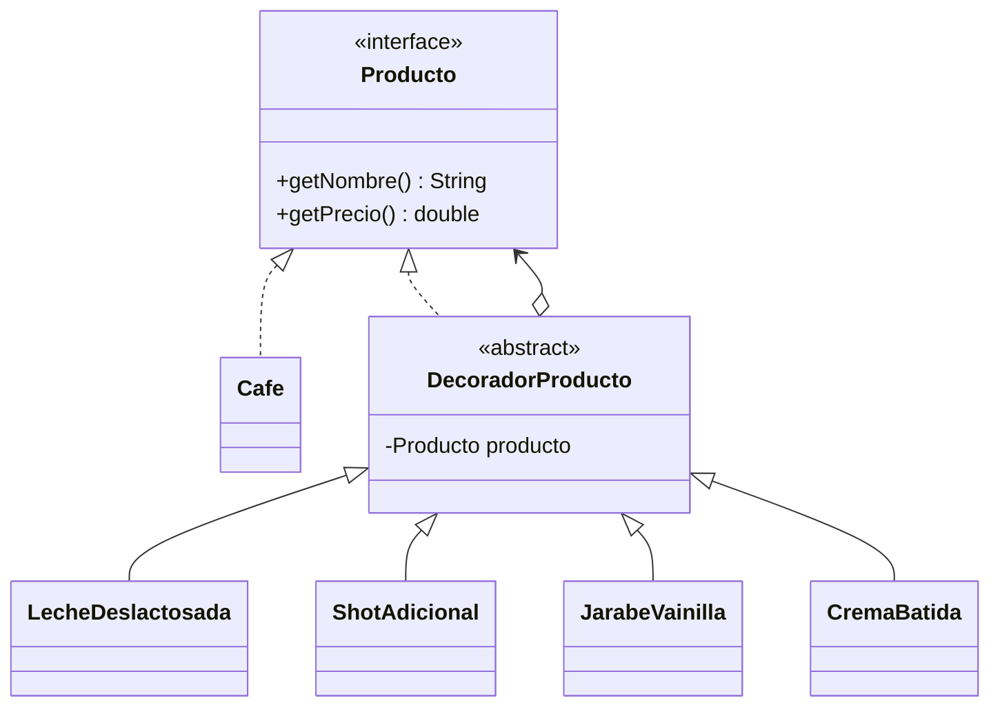

# Patrón Decorator

## Problema
En la cafetería un cliente puede pedir un café con diferentes complementos, por ejemplo leche deslactosada, un shot adicional, jarabe o crema batida. Crear una clase diferente para cada combinación haría que el proyecto tuviera demasiadas clases.

## Solución
Se usa el patrón Decorator. Los complementos envuelven un objeto que implementa `Producto`. Cada decorador conserva el nombre y el precio del producto anterior y agrega su propio texto y costo.

## Clases principales
- `Producto`: interfaz común de los productos.
- `Cafe`: producto inicial.
- `DecoradorProducto`: clase base de los complementos.
- `LecheDeslactosada`, `ShotAdicional`, `JarabeVainilla` y `CremaBatida`: agregan complementos y costo.

## Ejemplo
```java
Producto cafe = new ShotAdicional(new LecheDeslactosada(new Cafe()));
System.out.println(cafe.getNombre());
System.out.println(cafe.getPrecio());
```
El resultado es un café con leche deslactosada y shot adicional, por $7.000.

## Diagrama de clases


## Alternativa que no se eligió
Crear una clase para cada combinación de café y complementos. Esa opción repetiría código y crecería mucho cuando se agreguen nuevos complementos.

## Ventajas
- Se pueden combinar complementos.
- Se pueden agregar opciones sin modificar la clase `Cafe`.
- Cada complemento tiene su propia responsabilidad.

## Desventajas
- Al combinar muchos complementos, el objeto queda envuelto en varias capas.
- Puede ser más difícil revisar el objeto si no se conoce el orden de los decoradores.

## Relación con SOLID
Ayuda a cumplir el principio abierto/cerrado, porque se agregan complementos creando nuevas clases sin modificar el producto base.
