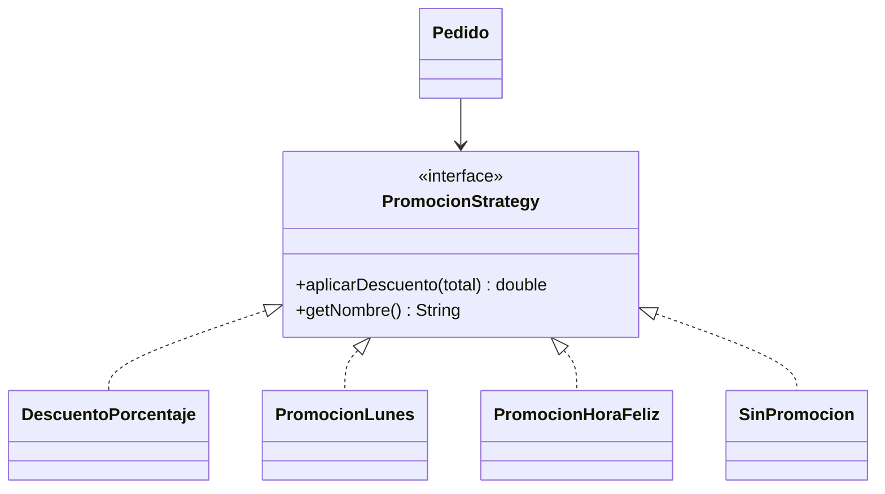

# Patrón Strategy

## Problema
La cafetería puede manejar diferentes promociones. Si todos los descuentos estuvieran escritos con muchos `if` dentro de `Pedido`, sería más difícil agregar o cambiar promociones.

## Solución
Se usa Strategy. Todas las promociones implementan `PromocionStrategy`, que define cómo calcular el descuento. El pedido recibe la estrategia que se desea utilizar.

## Clases principales
- `PromocionStrategy`: interfaz de las promociones.
- `DescuentoPorcentaje`: permite definir un porcentaje y un nombre.
- `PromocionLunes`: aplica un 15% de descuento.
- `PromocionHoraFeliz`: aplica un 10% de descuento.
- `SinPromocion`: deja el total igual.
- `Pedido`: utiliza la estrategia seleccionada para calcular el total.

## Ejemplo
```java
Pedido pedido = new Pedido(1);
pedido.setPromocion(new PromocionLunes());
double total = pedido.getTotal();
```

## Diagrama de clases


## Alternativa que no se eligió
Poner todas las condiciones de promociones dentro de una sola clase con varios `if`. Esa alternativa haría que la clase del pedido tuviera que conocer cada promoción.

## Ventajas
- Cada promoción está separada.
- Se puede cambiar la promoción sin modificar el cálculo general del pedido.
- Es sencillo agregar una nueva estrategia.

## Desventajas
- Se crean clases adicionales para cada promoción.
- El programa debe escoger cuál estrategia usar.

## Relación con SOLID
Ayuda a cumplir el principio abierto/cerrado y permite que `Pedido` dependa de una interfaz en vez de depender de cada promoción concreta.
